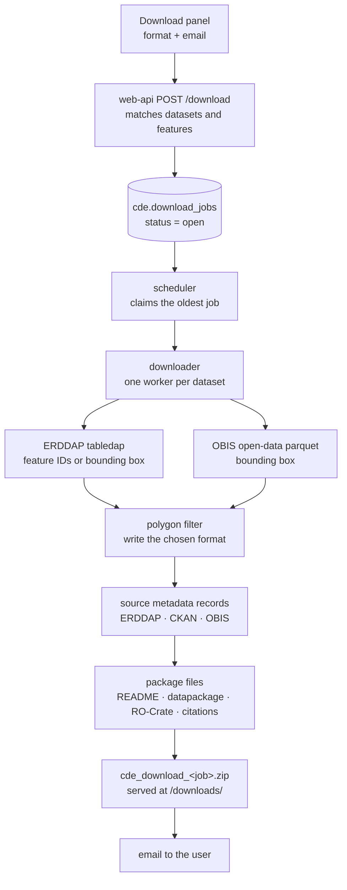

# Download packages

> **Harvest docs:** [Workflow](workflow.md)
> · [ERDDAP](erddap.md)
> · [OBIS](obis.md)
> · **Downloads**

This page describes what happens between a user pressing **Submit** in the
Download panel and the email with their zip: how the request is queued, how
each dataset's subset is fetched and filtered, and what the package contains.
The aim is a package that explains itself: every subset carries its request
URLs, the filters applied, its metadata and a citation, and every dataset that
could not be included says why.



## 1. The request

The Download panel sends `POST /download` with the same filter query string the
map uses, plus:

| Parameter | Meaning |
| --- | --- |
| `datasetPKs` | The datasets ticked in the panel |
| `polygon` | The drawn polygon as GeoJSON, only when **Filter by polygon** is on |
| time / depth | Reset to the full range when their download switch is off |
| `format` | `csv` (default), `parquet`, `odv` or `nccf` |
| `lang` | `en` or `fr`: the language of the README and the email order |

The email travels in the JSON body, never the URL, so it stays out of access
logs and traces.

## 2. Queueing

`web-api/routes/download.js` runs the same search as the map over profiles,
trajectory hexes and OBIS cells, then writes one row to `cde.download_jobs`.
Its `downloader_input` holds:

- `user_query`: time, depth, lat/lon box, the polygon as WKT, the format, every
  filter as sent (for the README), the email and a 6-character `job_id`.
- `cache_filtered`: one entry per matched dataset, with its ERDDAP URL and ID,
  titles, `cdm_data_type`, CKAN ID, the harvested `metadata` (citation, DOI,
  licence, contacts) and `table_variables`.
- For `TimeSeries`, `TimeSeriesProfile` and `Profile` datasets, the IDs of the
  stations or profiles the search matched (`feature_ids`, up to 5000) and the
  ERDDAP variable that holds them (`feature_id_variable`).

## 3. Scheduling

The `scheduler` service (`download_scheduler/`) polls every 0.5 s and claims the
oldest `open` job with `FOR UPDATE SKIP LOCKED`, so several schedulers never
take the same job. It is deliberately not on the Prefect pool (see the README's
**Downloads** section), but each job still appears in Prefect as a
`Download Job` flow run when `PREFECT_API_URL` is set.

## 4. Fetching each dataset

The downloader (`downloader/cioos_downloader/download_erddap.py`) fetches
datasets from up to 6 servers in parallel, but one at a time per server (one
worker per server), so no ERDDAP ever serves two of our requests at once. A
dataset that fails never stops the others.

### ERDDAP

One tabledap request per subset, in the chosen format's ERDDAP response type:

| Format | ERDDAP response | Polygon |
| --- | --- | --- |
| CSV | `.csv` | Rows outside are dropped |
| Parquet | `.parquetWMeta` (ERDDAP attributes kept in the file) | Rows outside are dropped |
| ODV spreadsheet | `.odvTxt` (its `//` header kept) | Rows outside are dropped |
| NetCDF (CF) | `.ncCF` (a CF discrete-sampling-geometry file) | Observations outside are dropped and the ragged array (`rowSize`, parent index) is rebuilt |

How the request is constrained:

1. **Time and depth** always go to ERDDAP. The panel's dates are whole days,
   so the range runs from 00:00:00Z on the first to 23:59:59Z on the last.
2. **Space:** when the dataset came with `feature_ids`, ERDDAP is asked for
   exactly those features (`profile=~"(id1|id2|…)"`). Otherwise the request
   carries the polygon's bounding box, or the lat/lon box when no polygon was
   drawn. A polygon that crosses ±180° is split into one request per side.
3. **Long ID lists** are split so each URL stays under 6000 characters. Past 8
   requests, or when an ID contains a character the regex can't escape, the
   bounding box is used instead.
4. The **polygon** is then applied exactly to the downloaded rows, whatever the
   format. Values other than latitude/longitude are written back as received, so
   numbers keep ERDDAP's formatting.

The variable list comes from the harvested `table_variables`; only datasets
harvested before that column existed fall back to the dataset's ERDDAP info page
(`/info/<id>/index.csv`).

### OBIS

OBIS datasets are read from the OBIS open-data parquet export with DuckDB,
bounded by the box, then filtered on depth, time and the polygon. OBIS has no
ODV or CF rendition, so those formats fall back to CSV and the README says so.

### Limits and outcomes

| Limit | Value | What happens |
| --- | --- | --- |
| Per dataset | 1000 MB | CSV and ODV are cut at the last whole line and marked `PARTIAL`. Parquet and NetCDF can't be read once cut, so the dataset is `FAILED` (`DATASET_SIZE_LIMIT`) |
| Per download | 5000 MB | Datasets still waiting are `IGNORED` (`QUERY_SIZE_LIMIT`) and the job ends `over-limit` |
| Request timeout | 30 s to connect, 10 min between bytes | The dataset is `FAILED` |

Every dataset ends in one status, recorded with the server's own error text:

| Status | Included | Meaning |
| --- | --- | --- |
| `COMPLETED` | Yes | Data written |
| `PARTIAL` | Yes | Cut at the per-dataset limit |
| `EMPTY` | No | Nothing matched (ERDDAP's "no matching results" 404) |
| `FAILED` | No | The source returned an error (including ERDDAP's 404 for an unknown dataset ID), timed out, or the file couldn't be written |
| `IGNORED` | No | Skipped once the download size limit was reached |

## 5. Source metadata

Each dataset folder's `metadata/` receives the source's own records, copied as is
(`source_metadata.py`). A record that can't be fetched is a note in the README,
never a failed dataset.

| File | Source |
| --- | --- |
| `metadata.json` | The harvested `datasets.metadata` (see [descriptive metadata](workflow.md#descriptive-metadata)) |
| `erddap.nccsvMetadata` | `<erddap>/tabledap/<id>.nccsvMetadata`: ACDD/CF global and variable attributes |
| `ckan_iso19115.xml` | The ISO 19115-3 record the CIOOS catalogue harvested (`xml_location_url`), else `ckan_package.json` |
| `obis_dataset.json`, `eml.xml` | The OBIS dataset API, and the EML from the dataset's IPT |

## 6. The package

`package.py` writes these files from the downloader's report, then the folder is
zipped as `cde_download_<job_id>.zip`:

```
cde_download_<job_id>/
  README.md               data first: each included dataset's folder, rows and licence, then
                          what wasn't included and why, what each file is and how to open it
                          (open hints only for the formats present), the selection, citations,
                          links to each source record, how to reproduce, and what the package is
  README.html             the same, as a standalone page (no external requests) with a copy button per citation
  data/
    <dataset_id>_<host>/  one folder per dataset
      <dataset_id>_<host>.csv|parquet|txt|nc
      citation.txt
      metadata/           metadata.json, erddap.nccsvMetadata, ckan_iso19115.xml, obis_dataset.json, eml.xml
  citation/
    citations.txt / .bib / .ris
    licences.txt          the licence of each dataset
  reproduce.py            rebuild the data files (see below)
  datapackage.json        Frictionless Data Package v2
  ro-crate-metadata.json  RO-Crate 1.2 provenance
```

The data is what the user came for, so it sits in one place; the citation and
licence of every dataset are grouped in `citation/`. The two manifests stay at
the root, where their specifications require them, and serve different readers:

- **`datapackage.json`** describes each data file for tools: its path, sha256,
  size, media type, columns with units, the request URLs (`sources`) and
  licence. A CSV's units row is declared as a comment row, so Frictionless
  validates the table. Datasets with no file are listed under `x-cde-failed`,
  and the full query under `x-cde-query`. `x-cde-subsets` lists each included
  subset's folder, source, format and request URLs for `reproduce.py`.
- **`ro-crate-metadata.json`** records provenance: one `CreateAction` per
  dataset, with the source dataset (by DOI, else its landing page), the request
  URLs, start and end times, and `CompletedActionStatus` or
  `FailedActionStatus` with the error.

A download that matched nothing still produces a zip, so the user can read in
the README what each dataset returned.

### Reproducing a package

`reproduce.py` is a [uv](https://docs.astral.sh/uv/) script that installs
`downloader` from the public repository's archive: at the `downloader_url` the web API records in `user_query` (the
commit it was deployed from; the `development-v2` archive for jobs queued
without one), with `exclude-newer` set to when the package was built. It calls
`cioos_downloader.formats.reproduce()` on its own folder. uv is the only thing
the user installs: from the package folder, `uv run reproduce.py` re-fetches
every subset from its request URLs, applies the same polygon filter, writes the
files to `reproduced/` and prints `match`, `differs` or `missing` for each
against its sha256 in `datapackage.json`. A `PARTIAL` subset differs by design
(no size limit applies locally), as does one whose source data changed.

`reproduce.py` runs the code at that commit, so `cioos-data-explorer-downloader`
must stay installable on its own: it must never depend on the harvester (or
anything server-only).

### Dataset list

Without a polygon filter, the panel also saves a CSV with one row per dataset:
its raw source query, its CIOOS catalogue page, its licence and a one-line
citation. The queries are built in the browser (`frontend/src/downloadLinks.js`):
ERDDAP links request the package format's file type with the same time and
depth bounds; OBIS links use the v3 API (JSON, at most 10,000 records). The
licence and citation come from `GET /datasets/citations`, which cites as the
package's `source_citation` does (the source's own citation, else one built
from its metadata), without the subset note. With a polygon the list is not
offered: ERDDAP could only take its bounding box.

### Citations

Each included subset is cited in the way ESIP and the RDA dynamic-data-citation
recommendations describe: the source's citation, then the subset and when and
where it was retrieved.

> Hakai Institute (2021). CTD profiles. https://doi.org/10.1234/abc. Subset:
> time 2019-01-01 to 2020-01-01; depth 0 to 100 m; polygon area (see
> README.md). Retrieved 2026-10-16T16:10:06+00:00 from https://…/tabledap/…csv?…

The source citation is the harvested one (CKAN first, then OBIS, then ERDDAP).
Without one it is built from the cited contacts, publication year, title and
DOI or landing page. Datasets that weren't included get no citation.

## 7. The email

The scheduler records the job's status (`completed`, `no-data`, `over-limit`,
`failed`) and the full report in `download_jobs.erddap_report`, then emails the
link in both languages, the user's first. Datasets left out are listed with
their reason and the source's response. Emails are erased from finished jobs
after 7 days; only the domain is kept for usage counts.

## Checking a package

The files validate with the standard tools:

```sh
uvx frictionless validate datapackage.json
uvx --from roc-validator rocrate-validator validate -np -p ro-crate-1.2 -l required .
```

To run one query by hand against the live servers:
`downloader/test_downloader.sh tests/queries/no_polygon.json`.
